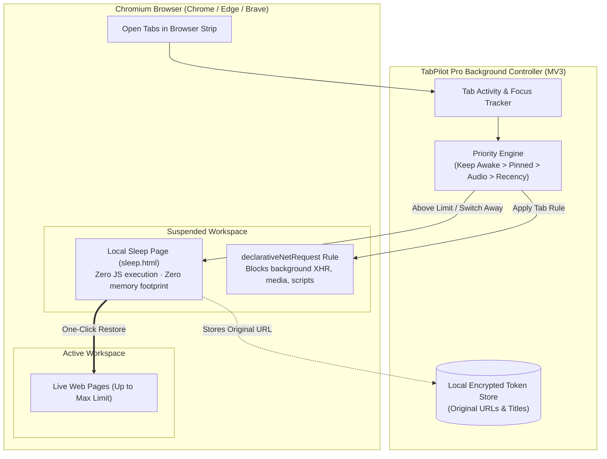

# TabPilot Pro — Smart Tab Memory & Sleep Manager

<p align="center">
  
</p>

<p align="center">
  <strong>High-Performance Tab Sleep, RAM Optimization & Network Blocker for Chromium</strong><br />
  Sleep inactive tabs without closing them, cut browser memory consumption up to 80%, block background network leaks, and recover lost sessions.
</p>

<p align="center">
  <a href="https://github.com/soahimrahman/TabPilot-Pro/releases"></a>
  <a href="https://developer.chrome.com/docs/extensions/mv3/intro/"></a>
  <a href="LICENSE"></a>
  <a href="https://github.com/soahimrahman/TabPilot-Pro/actions"></a>
  <a href="#-security-privacy--permissions"></a>
</p>

---

## ⚡ Why TabPilot Pro?

Modern web apps (YouTube, Gmail, Figma, Jira, social media) consume gigabytes of RAM in the background. Typical "tab killer" extensions simply close your tabs, cluttering your bookmarks or losing your workspace context.

**TabPilot Pro takes a different approach:**

- 🗂️ **Tabs Are Never Closed:** Sleeping tabs remain right where they belong in your browser tab strip with a discrete sleeping indicator.
- 💤 **Full Resource Unloading:** When a tab goes to sleep, its entire DOM, JavaScript execution, timers, WebSockets, and media elements are completely unloaded and replaced with a zero-resource local sleep screen.
- 🛡️ **Declarative Net Request Blocking:** Active background network requests, analytics pings, and polling calls for sleeping tabs are blocked at the engine level via Chrome's `declarativeNetRequest` session rules.
- ⚡ **Instant One-Click Restoration:** Click **"Restore this tab"** or select the tab to immediately return to your original webpage.
- ↶ **Emergency Session Recovery:** Accidental closures? TabPilot's built-in Recovery engine restores up to 60 recently closed tabs and windows using the native Chromium Sessions API.
- ⌨️ **Global Keyboard Shortcuts:** Sleep background tabs, toggle Keep Awake, or launch the Control Center with quick hotkeys.

---

## 🏗️ Architecture



---

## ✨ Features & Capabilities

| Feature | Description |
| :--- | :--- |
| **Intelligent Sleep Mode** | Automatically unloads inactive tabs once your configured live-tab threshold is reached (e.g. 5 tabs). |
| **Sleep on Switch** | Puts the tab you just left to sleep immediately, giving you maximum RAM savings as you jump between tasks. |
| **Network Traffic Blocker** | Uses `declarativeNetRequest` to stop sleeping tabs from wasting your bandwidth with background AJAX, analytics pings, or streaming data. |
| **Auto-Refill** | When you close an active tab, TabPilot automatically wakes the most relevant sleeping tab into the newly opened slot. |
| **Smart Protections** | Pinned tabs, tabs actively playing audio or video, and user-marked **Keep Awake** tabs are automatically protected from sleep. |
| **Full Control Center** | A rich management dashboard (`dashboard.html`) to group tabs by status, window, or domain, with bulk sleep/wake and search filters. |
| **Emergency Recovery** | Deep integration with Chrome's `sessions` API to recover up to 60 recently closed tabs across multiple windows with automatic sleep suppression. |
| **Keyboard Shortcuts** | Native hotkeys to trigger actions instantly without taking your hands off the keyboard. |

---

## ⌨️ Keyboard Shortcuts

| Shortcut (Windows / Linux) | Shortcut (macOS) | Action |
| :--- | :--- | :--- |
| <kbd>Alt</kbd> + <kbd>Shift</kbd> + <kbd>D</kbd> | <kbd>⌥</kbd> + <kbd>Shift</kbd> + <kbd>D</kbd> | Open TabPilot Pro Control Center |
| <kbd>Alt</kbd> + <kbd>Shift</kbd> + <kbd>K</kbd> | <kbd>⌥</kbd> + <kbd>Shift</kbd> + <kbd>K</kbd> | Toggle **Keep Awake** protection on current tab |
| <kbd>Alt</kbd> + <kbd>Shift</kbd> + <kbd>O</kbd> | <kbd>⌥</kbd> + <kbd>Shift</kbd> + <kbd>O</kbd> | Put all other inactive tabs in the window to sleep |

*(Shortcuts can be customized anytime via `chrome://extensions/shortcuts` or `edge://extensions/shortcuts`)*

---

## 🚀 Installation Guide

### Step 1: Download or Clone the Repository

```bash
git clone https://github.com/soahimrahman/TabPilot-Pro.git
cd TabPilot-Pro
```

*(Alternatively, click **Code → Download ZIP** on GitHub and extract it to a permanent folder).*

---

### Step 2: Load into Chrome, Edge, or Brave

1. Open your browser and navigate to:
   - **Google Chrome / Brave:** `chrome://extensions`
   - **Microsoft Edge:** `edge://extensions`
2. Turn on **Developer mode** (toggle switch in the top-right corner).
3. Click the **Load unpacked** button.
4. Select the `TabPilot-Pro` folder.
5. Click the puzzle icon in your browser toolbar and pin **TabPilot Pro**!

---

### Step 3: Configure Your Preferences

1. Click the **TabPilot Pro** toolbar icon.
2. Toggle **Enable Sleep Mode** to **ON**.
3. Choose your live-tab limit (e.g. 5 tabs).
4. *(Optional)* Turn on **Sleep previous tab on switch** for aggressive memory optimization.
5. Click **Save & apply settings**.

---

## 🖥️ The Control Center (`dashboard.html`)

Access the full studio dashboard anytime by clicking **"Open full admin dashboard"** in the popup, or pressing <kbd>Alt</kbd> + <kbd>Shift</kbd> + <kbd>D</kbd>:

- **Overview:** Live real-time meter of loaded vs. sleeping tabs, memory status, and recent activity logs.
- **Tab Groups:** Sort tabs by **Status** (Live, Protected, Sleeping, Unsupported), **Browser Window**, or **Website/Domain**. Collapsible groups with bulk Wake, Sleep, and Keep Awake controls.
- **Rules Engine:** Fine-tune automation rules, network blocking, audio detection, and pinned-tab exceptions.
- **Emergency Recovery:** Inspect Chrome's recently closed session stack and restore closed tabs with one click.

---

## 🔒 Security, Privacy & Permissions

TabPilot Pro is built with a zero-compromise privacy design:

- **100% Local Execution:** Everything runs locally within your browser's extension sandbox. No accounts, logins, telemetry, or remote servers.
- **Local Storage Isolation:** Sleeping tab URLs and titles are stored locally in extension storage under randomly generated ephemeral tokens. The visible sleep URL never leaks your original browsing destination.
- **Explicit Least Privilege:**
  - `tabs`: Read tab state, update URLs, and discard loaded pages.
  - `storage`: Save user configuration and sleeping tab mappings locally.
  - `alarms`: Periodically reconcile tab states after MV3 service-worker restarts.
  - `declarativeNetRequest`: Block tab-attributed network requests while asleep.
  - `sessions`: Restore recently closed tabs in the Recovery dashboard.

---

## 🧪 Testing & Verification

Run the automated test suite locally:

```bash
npm test
```

Verify JavaScript syntax:

```bash
npm run check
```

---

## 📁 Project Directory Structure

```text
TabPilot-Pro/
├── .github/
│   └── workflows/
│       └── ci.yml             # Multi-OS automated CI workflow (Ubuntu, Windows, macOS)
├── icons/                     # Extension branding icons (16, 32, 48, 128px)
├── tests/                     # Unit test suites
│   ├── extension.test.js      # Manifest, asset & file integrity tests
│   └── logic.test.js          # Clamping, URL validation & key parsing tests
├── manifest.json              # Chrome Manifest V3 configuration & commands
├── service-worker.js          # MV3 background supervisor, DNR & tab lifecycle manager
├── popup.html                 # Quick dropdown control panel
├── popup.css                  # Popup dark-mode styling
├── popup.js                   # Popup view controller & state sync
├── dashboard.html             # Full-tab Control Center & Workspace Dashboard
├── dashboard.css              # Control Center responsive styles
├── dashboard.js               # Tab groups, search filter & recovery controller
├── sleep.html                 # Sleek 404 local tab sleep screen
├── sleep.css                  # Sleep screen styling & animations
├── sleep.js                   # Tab restoration & metadata controller
├── sleep-icon.svg             # Vector sleep icon
├── sleep-icon.png             # Raster sleep icon
├── shared.css                 # Global design system & theme variables
├── package.json               # Test scripts & project metadata
├── .gitignore                 # Standard Git exclusion patterns
├── LICENSE                    # MIT License
└── README.md                  # Project documentation
```

---

## 📄 License

This project is open-source software licensed under the [MIT License](LICENSE).

---

<p align="center">
  Crafted with care by <a href="https://github.com/soahimrahman">Soahim Rahman</a>.
</p>
